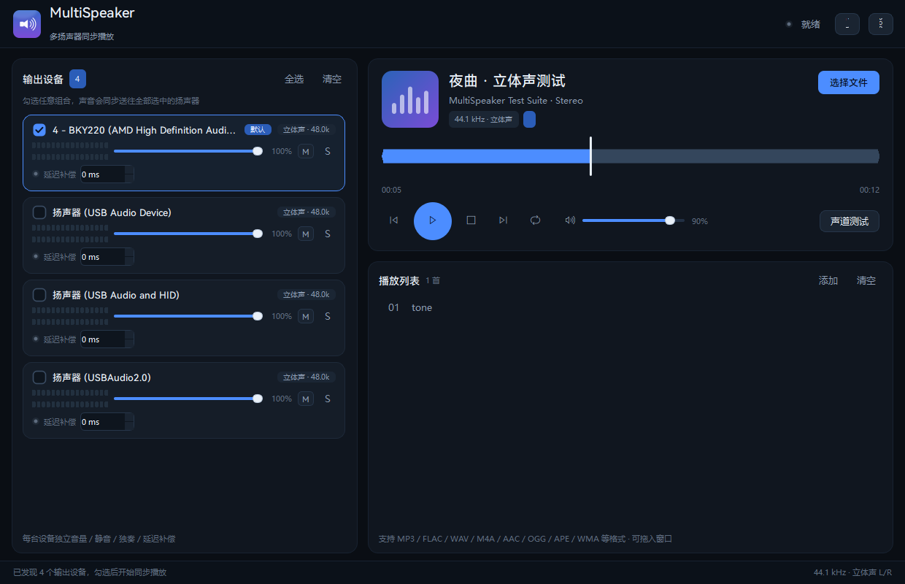
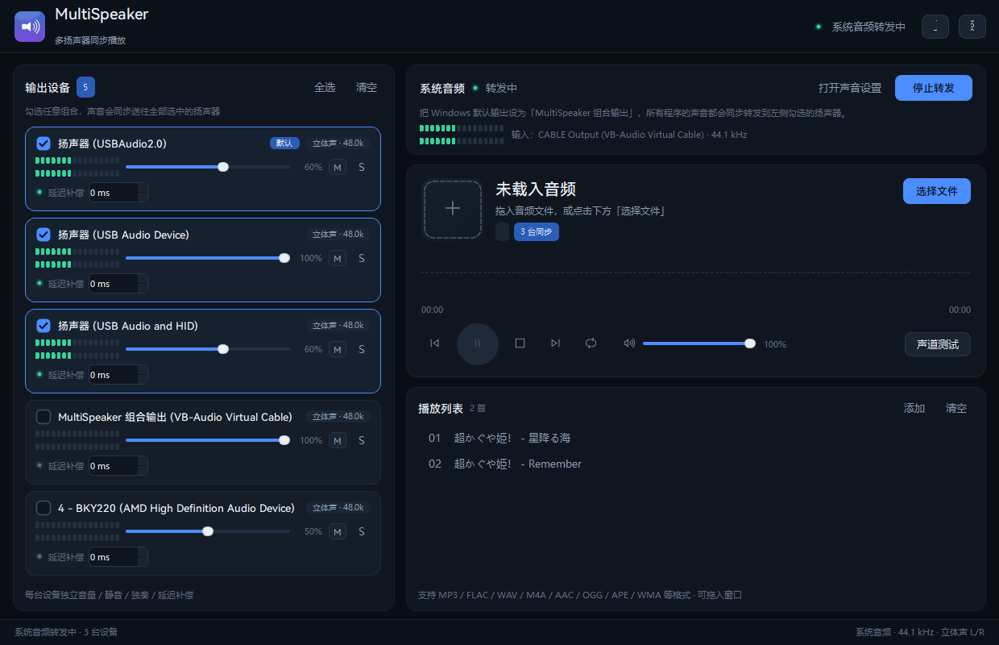
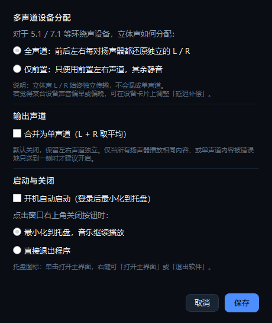

<div align="center">
  
  <h1>MultiSpeaker · 多扬声器同步播放器</h1>
  <p>把同一个立体声音频同时送到 Windows 上任意多个扬声器，<br>每台设备都保留独立的左 / 右声道 —— 永远不会混成单声道。</p>
  <p>
    
    
    
    
  </p>
</div>

> One stereo stream, many speakers — every endpoint keeps its own left/right channels, sample-accurately synchronised by a shared master clock. Windows 10/11 x64.

> **许可 / License**：本项目采用 **AGPL-3.0**。任何人都可以自由使用、修改、商用，
> 但**分发修改版**或**通过网络提供修改版的服务**时，必须以 AGPL-3.0 公开全部源码。
> Licensed under AGPL-3.0 — modified versions must be open-sourced when distributed or offered over a network.

---

## 这是什么

Windows 上常见的问题是：一块声卡只能选一个输出，想让「USB 音箱 + HDMI 功放 + 蓝牙音箱」同时响，
只能靠第三方虚拟声卡或专业音频软件，而且很多方案会把立体声**下混成单声道**。

MultiSpeaker 直接面向 WASAPI 端点：

- 勾选任意多个扬声器 → 同一份立体声同时送往全部设备
- 每台设备都有**独立的 L / R 电平表**，左右声道分别传输，绝不求平均
- 所有设备由**同一条主时钟**对齐，并按各自上报的输出延迟提前读取，长时间播放不会逐渐错位
- 每台设备可以单独调音量、静音、独奏，或用「延迟补偿」对齐蓝牙音箱
- 配合虚拟声卡，还能把**整个系统的声音**（浏览器、游戏、音乐软件）变成「组合输出」



## 功能

| | |
|---|---|
| **任意组合** | 枚举全部 WASAPI 渲染端点，勾选即播放；播放中增删设备立即生效 |
| **真立体声** | 显式声道映射（FL/FR/FC/LFE/BL/BR/SL/SR），L/R 独立；实测左右分离约 **108 dB** |
| **单声道选项** | 默认保持立体声；播放器上的「立体声 / 单声道」标签可一键切换为 L+R 合并 |
| **同步引擎** | 主时钟 + 每设备延迟补偿 + ±0.4% 漂移校正，实测 3 台设备同时播放 **0 欠载** |
| **系统音频** | 配合 VB-CABLE，把「MultiSpeaker 组合输出」变成 Windows 播放设备，全系统声音一起转发 |
| **每设备控制** | 音量、静音 (M)、独奏 (S)、延迟补偿（−300…+300 ms）、L/R 电平表 |
| **声道测试** | 内置「左 → 右 → 双声道」测试信号，快速确认每台设备都是独立立体声 |
| **播放器** | 拖放 / 播放列表 / 上一首下一首 / 单曲循环 / 波形进度拖动 / 空格快捷键 |
| **格式** | MP3、FLAC、WAV、M4A(AAC)、OGG、OPUS、WMA、AIFF、APE、MP4、MKV（FFmpeg 解码） |
| **采样率** | 44.1k / 48k / 96k 等自动转换到设备采样率（soxr HQ） |
| **托盘 / 自启** | 开机自动启动并静默驻留托盘；关闭窗口可选「最小化到托盘」或「退出」 |
| **细节** | 设置自动保存、单实例、二次启动唤起窗口、卸载清理启动项 |

## 截图

| 系统音频转发 | 设置 |
|---|---|
|  |  |

## 安装

### 方式一：安装包（推荐）

从 [Releases](../../releases) 下载 `MultiSpeaker-Setup-*.exe`，双击安装。
安装到 `C:\Program Files\MultiSpeaker`，会创建桌面与开始菜单快捷方式，并注册卸载项。

> 安装需要一次管理员确认（UAC）；程序运行本身**不需要**管理员权限。

### 方式二：便携版

下载 `MultiSpeaker-Portable.zip`，解压到任意目录，运行 `MultiSpeaker.exe` 即可。

### 方式三：从源码运行

```powershell
git clone https://github.com/LinYuxia-YC/MultiSpeaker.git
cd MultiSpeaker
pip install -r requirements.txt
python main.py
```

要求 Windows 10/11 x64、Python 3.10+。首次运行会自动选中系统默认输出设备。

## 使用

1. 左侧「输出设备」勾选要同时发声的扬声器（可多选）
2. 点右上角「选择文件」，或把音频文件 / 文件夹拖进窗口
3. 点播放（或按空格）——所有勾选设备同时开始
4. 点「声道测试」确认每台设备都是独立立体声

每张设备卡片上：

- **音量滑杆**：只影响这一台设备
- **M**：静音这台设备
- **S**：独奏，只听这一台（用来分辨哪个音箱对应哪个设备）
- **延迟补偿**：正值 = 这台设备相对其他设备更晚出声，用于对齐蓝牙音箱等

### 把组合变成 Windows 播放设备（系统音频）

Windows 不允许普通应用注册音频端点，因此需要一个签名的虚拟声卡（推荐官方免费的
[VB-CABLE](https://vb-audio.com/Cable/)）：

1. 安装 VB-CABLE（官方免费，签名驱动）
2. Windows 的「播放设备」里会出现 **MultiSpeaker 组合输出 (VB-Audio Virtual Cable)**
   （重命名方法见 [docs/使用说明.md](docs/使用说明.md)）
3. 把 Windows 默认输出设为它
4. 回到 MultiSpeaker，勾选要发声的扬声器，点「系统音频 → 开始转发」

之后浏览器、游戏、音乐软件的声音都会同步出现在这些扬声器上。

> 转发链路有约 80 ms 缓冲（端到端约 100 ms）；观看视频时如需唇音同步，请在播放器里做音频延迟补偿。

### 托盘与开机自启

- 设置（右上角齿轮）→「启动与关闭」：开机自动启动、关闭按钮行为（托盘 / 退出）
- 托盘图标：单击打开主界面；右键菜单可「打开主界面」或「退出 MultiSpeaker」
- 重复启动程序会把已运行的窗口唤到前台，不会出现两个实例

## 工作原理

```text
音频文件 ──▶ PyAV/libav 解码 ──▶ float32 立体声 PCM
                                      │
系统声音 ──▶ 虚拟声卡 ──▶ 环形缓冲 ──┤
                                      ▼
                          按设备采样率重采样（soxr HQ）
                                      │
                    ┌─────────────────┼─────────────────┐
                    ▼                 ▼                 ▼
              设备 1（48 kHz）   设备 2（44.1 kHz）  设备 N（44.1 kHz）
                    │                 │                 │
              WASAPI 共享模式输出（各自独立流）
```

### 时间轴

所有设备共用一条“可听时间轴”，设备 *i* 在墙钟时间 *t* 读取源位置：

```text
pos_i(t) = (t + latency_i − t0) · rate_i
```

即**按自身输出延迟提前读取**，让同一采样在所有扬声器上同时响起。
每次回调再用 `perf_counter()` 与目标位置比较，误差超过 1.5 ms 时用 ±0.4% 的比例做缓慢的分数延迟校正
（Catmull-Rom 插值），既不会累积漂移，也听不出音高变化。

### 声道分配

对于 5.1 / 7.1 设备，立体声按 Windows 默认声道顺序显式展开：

| 设备声道 | 内容 |
|---|---|
| FL / FR | L / R |
| FC | (L+R)·0.25 |
| LFE | 静音 |
| BL / BR · SL / SR | L / R（−3 dB） |

L / R 永远独立传输，不会出现「两声道相加后平均」的单声道结果。

## 项目结构

```text
main.py                 入口（GUI / --selftest / --screenshot / --tray）
app/
  devices.py            WASAPI 端点枚举
  decode.py             PyAV 解码 → float32 立体声
  resample.py           soxr / scipy / 线性 重采样
  engine.py             多设备同步播放引擎（核心）
  live.py               虚拟声卡实时采集（环形缓冲）
  autostart.py          开机自启（HKCU Run）
  testtone.py           内置声道测试信号
  ui/theme.py           QSS 深色主题
  ui/widgets.py         自绘控件（电平表、波形进度、设备卡片）
  ui/main_window.py     主窗口、托盘、设置
build.ps1               PyInstaller 打包脚本
installer/              Inno Setup 安装脚本
docs/                   使用说明与截图
tools/                  开发期验证脚本（设备/解码/同步/回环）
```

## 构建

```powershell
pip install -r requirements.txt pyinstaller

# 免安装目录版 + 单文件便携版（dist/）
.\build.ps1

# 安装包（需要 Inno Setup 6 + 简体中文语言文件，见 installer/README.md）
& "C:\Program Files (x86)\Inno Setup 6\ISCC.exe" installer\MultiSpeaker.iss
```

打包后的程序自带 Python 运行时与 FFmpeg/soxr/PortAudio，无需用户另装依赖。

## 验证数据

| 项目 | 结果 |
|---|---|
| 3 台设备同时开流 | 0 欠载，单流延迟 24 ms |
| 左右声道分离度（WASAPI 回环采集，文件模式） | **≈108 dB** |
| 左右声道分离度（系统音频转发） | **≈90 dB** |
| MP3 / FLAC / WAV / M4A 解码 | L/R 相关系数 ≈ 0，立体声完整 |
| 打包后自检（设备 / 解码 / 重采样 / 开流 / 虚拟声卡） | 全部通过 |
| 单实例唤起 | 第二个进程 0.9 s 内退出并唤起已有窗口 |

## 已知限制

- 仅 Windows 10/11 x64；使用 WASAPI 共享模式，不会独占设备
- 跨设备的“绝对同时”取决于驱动上报的延迟；若某设备明显偏早/偏晚，用「延迟补偿」微调
- 单声道端点（极少见）只能输出单声道，界面会标注
- 超过 3 小时的超长音频会被拒绝载入（整轨解码进内存，保证拖动进度即时响应）
- 系统音频模式需要自行安装虚拟声卡（VB-CABLE / VoiceMeeter），本项目不附带驱动

## 第三方组件

| 组件 | 用途 | 许可 |
|---|---|---|
| [PySide6 / Qt 6](https://www.qt.io/) | GUI | LGPLv3 |
| [PyAV / FFmpeg](https://github.com/PyAV-Org/PyAV) | 解码 | LGPL 2.1+ |
| [soxr](https://github.com/dofuuz/python-soxr) | 重采样 | LGPL 2.1 |
| [PortAudio](https://www.portaudio.com/) / [sounddevice](https://github.com/spatialaudio/python-sounddevice) | WASAPI 访问 | MIT |
| [NumPy](https://numpy.org/) | 音频运算 | BSD-3-Clause |
| [Inno Setup](https://jrsoftware.org/isinfo.php) | 安装包 | Freeware |
| [VB-CABLE](https://vb-audio.com/Cable/) | 虚拟声卡（**未随本项目分发**） | 免费软件 |

## 作者

- **YuXiaYC**
- **Deepseek Harness**

如果这个项目对你有帮助，欢迎 Star、提 Issue 或 PR。

## License

本项目采用 **[GNU Affero General Public License v3.0](LICENSE)**（AGPL-3.0）。

| 场景 | 要求 |
|---|---|
| 个人使用、修改、商用 | ✅ 自由使用，无需付费 |
| 分发修改版（exe / 安装包 / 源码） | ⚠️ 必须以 AGPL-3.0 公开**全部**修改与完整源码 |
| 用修改版提供网络服务（SaaS） | ⚠️ 必须向使用者提供完整源码 |
| 只在自己内部修改、不分发、不对外提供服务 | ✅ 无需公开 |

简单说：**改了就要开源**——只要你把改动交给别人，或让别人通过网络用到它。

> 本项目是 OSI 认可的开源软件。提交 PR 即表示同意以相同许可（AGPL-3.0）授权你的贡献。

Copyright (C) 2026 YuXiaYC, Deepseek Harness
